# Lab 1 — Bob + Planning Analytics via MCP

**Duration:** 60 minutes
**Mode:** 📊 Planning Analytics
**Prerequisite:** [Lab 0](../lab-00-setup/README.md) ✅

---

## What You Will Do

| Exercise | Task | Time |
|----------|------|------|
| [1](#exercise-1--explore) | Explore servers, cubes, dimensions | 8 min |
| [2](#exercise-2--query) | Query cube data in plain English | 10 min |
| [3](#exercise-3--variance-analysis) | Budget vs Actual variance analysis | 10 min |
| [4](#exercise-4--outlier--impact-analysis) | Outlier detection and key drivers | 10 min |
| [5](#exercise-5--build-a-tm1-model-from-csv) | Build a cube and load data from CSV | 7 min |

Switch to **📊 Planning Analytics** mode before starting.

---

## Step 0 — Warm Up the PA Query Engine (30 seconds)

> ⚠️ **Do this before Exercise 2.** On a freshly started TechZone instance the PA grid service (query engine) uses lazy initialisation and may not be running yet. MDX queries will return a `409` error until it is warmed up.

1. Open the PAW URL from your TechZone reservation in a browser and log in as `pm` / `IBMDem0s`
2. Go to **Data and Models** → **New workbench** → expand any server → right-click any cube → **Add new view**
3. Wait ~30 seconds
4. Return to Bob — queries will now work

This only needs to be done **once per session**.

---

## Exercise 1 — Explore

```
List all available TM1 servers
```
Note the server name returned — you'll use it throughout this lab.

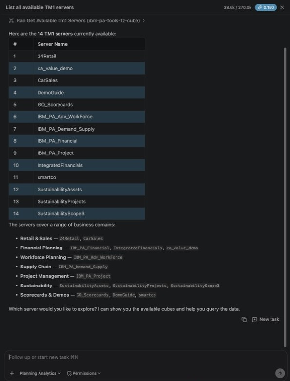

```
Show me all cubes available on the server, including which ones are pre-analyzed
```
Note which cubes show `is_analyzed: true` — these support natural language queries in Exercise 2. Bob asks which server to use — pick `smartco`.

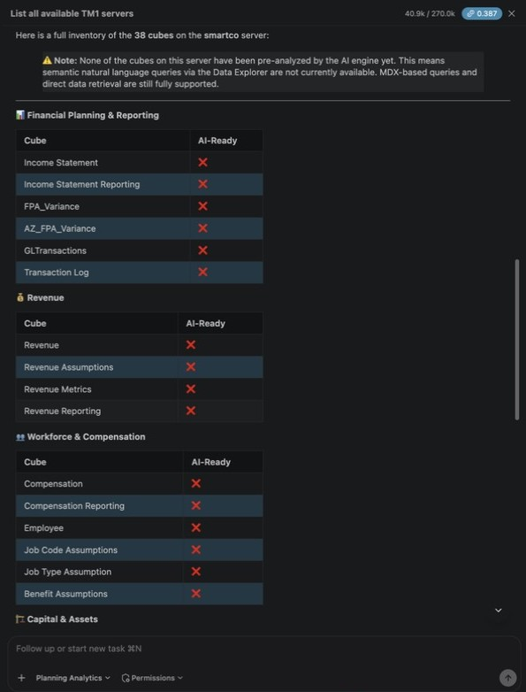

```
Show me the dimensions and sample members for the [cube name] cube
```

Use `FPA_Variance` as the cube name. Expected: 6 dimensions — `FPA_Account`, `FPA_Department`, `FPA_Scenario`, `FPA_Time`, `FPA_Version`, `FPA_Measures`.

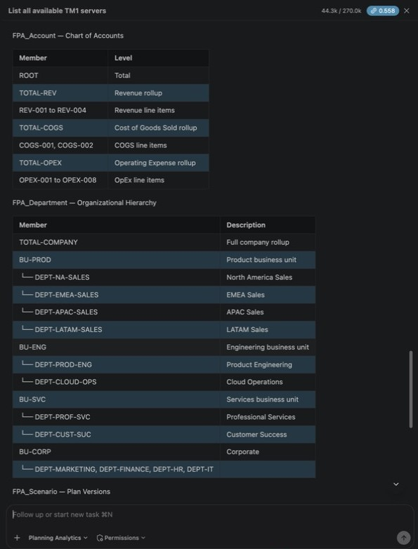

---

## Exercise 2 — Query

> Use a pre-analyzed cube from Exercise 1 if there is one. If `FPA_Variance` is **not** pre-analyzed (the default on TechZone), the prompts below still work — Bob falls back to MDX automatically and finds Budget in version V2 and Actual in V1.

```
Show me revenue data for Q1 2024 by department in the FPA_Variance cube on smartco
```

```
Show me budget vs actual revenue for January 2024, broken down by department,
in the FPA_Variance cube on smartco
```

```
Which departments had the largest revenue gap between budget and actual
in the FPA_Variance cube on smartco?
```

Expected for January 2024 total revenue: TOTAL-COMPANY $1,975,000 budget vs $1,828,000 actual (-$147,000, -7.4%); the biggest gap is DEPT-NA-SALES (-$173,000, -25.4%).

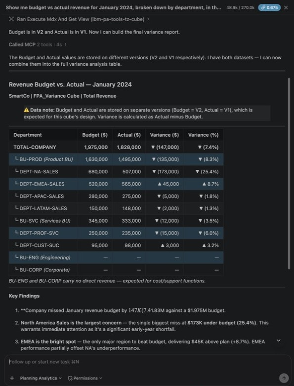

---

## Exercise 3 — Variance Analysis

```
Perform a full variance analysis on revenue for January 2024 across all departments
in the FPA_Variance cube on smartco.
Identify all variances greater than $100,000 or greater than 20%, and explain what you find.
```

Expected: only DEPT-NA-SALES crosses the threshold at department level (-$173,000, -25.4%).

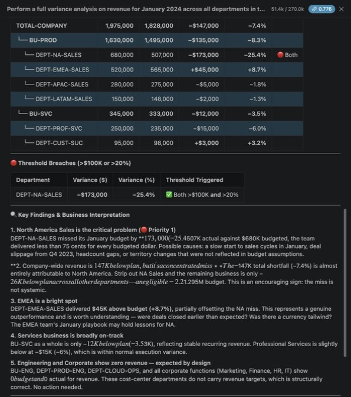

```
Save this variance view as "MY_INITIALS_Jan2024_Revenue_Variance" for future reference
```

> Bob saves it as a **public** view on the shared `FPA_Variance` cube, so use your initials to avoid overwriting someone else's view. The first save attempt may return a connection error — Bob retries automatically.

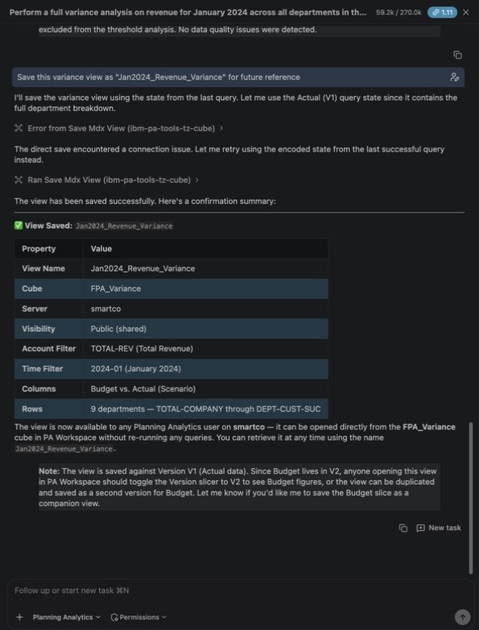

```
Compare January 2024 actual revenue (scenario Actual, version V1, period 2024-01)
with prior-year actual (scenario PY-ACT, version V1, period 2023-01)
for NA Sales, EMEA Sales and APAC Sales, account REV-001,
in the FPA_Variance cube on smartco. Show year-over-year growth rates.
```

> Expected YoY: NA 325K vs 450K (-27.8%); EMEA 420K vs 350K (+20.0%); APAC 275K vs 250K (+10.0%).

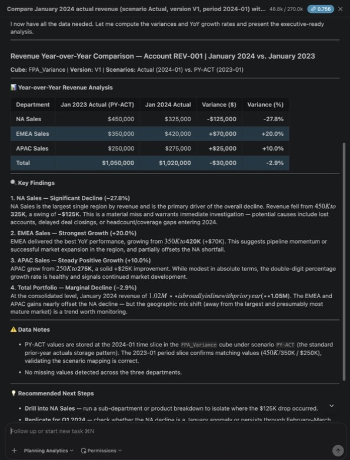

---

## Exercise 4 — Outlier & Impact Analysis

> **Set expectations before running:**
> - Outlier detection on 6 departments × 1 month typically returns "no outliers detected" — too few points. Try the wider slice below for better results.
> - `perform_impact_analysis` returns unlabeled x/y scores; the two-tool chain with `get_impact_analysis_summary` may not work. The **PDF report** is the main deliverable for this exercise.

```
Detect statistical outliers in REV-001 revenue for January–June 2024
across all departments in the FPA_Variance cube on smartco.
Explain what you find in business terms.
```

> In testing the outlier detection service returned HTTP 500 and Bob ran the statistics itself from the raw data. The dataset has no April–June actuals for some regions (EMEA April, APAC May–June, LATAM April–June), so Bob flags those zeros as outliers / missing loads — that is expected. NA's January dip and February spike are the real business story.

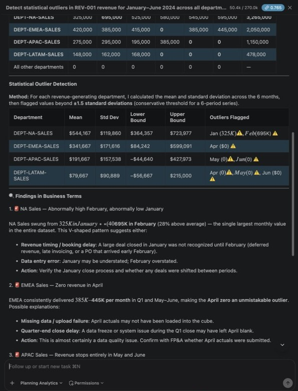

```
What are the key drivers of the revenue variance in January 2024
in the FPA_Variance cube on smartco?
Which factors have the highest impact on the total variance?
```

```
Generate a PDF analysis report for the January 2024 revenue data
in the FPA_Variance cube on smartco
```

> The report is generated on the PA server. It reads a single version (V1), so the **Budget column shows 0** — budget lives in V2. This is expected; do not treat it as missing data.

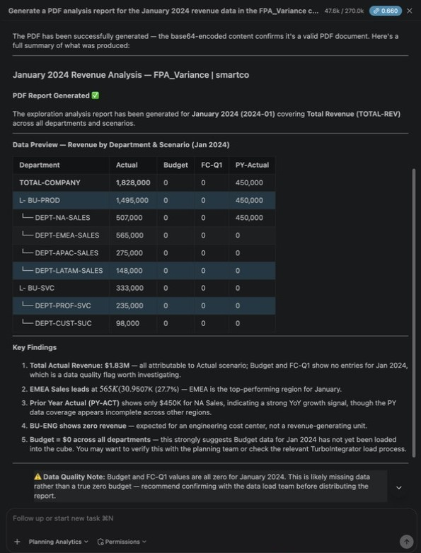

---

## Exercise 5 — Build a TM1 Model from CSV

The CSV files are in [`lab-01-bob-planning-analytics-mcp/assets/`](./assets/).

> ⚠️ **This workshop uses a shared `smartco` server.** Lab 2 and Lab 3 depend on a shared `FPA_Variance` cube — do NOT modify or delete it. Build your own private copy using your initials as a prefix.

```
I have CSV files in the lab-01-bob-planning-analytics-mcp/assets/ folder for an FP&A model.
Read the dimension files (dim_account.csv, dim_department.csv, dim_scenario.csv,
dim_time.csv, dim_version.csv) and the fact file (fact_financial_data.csv).

Create a complete TM1 model on the smartco server using MY_INITIALS as a prefix
(replace MY_INITIALS with your actual initials, e.g. "JD"):
- Create dimensions named MY_INITIALS_FPA_Account, MY_INITIALS_FPA_Department, etc.
- Store descriptive CSV columns as text attributes (not aliases)
- Create a cube called MY_INITIALS_FPA_Variance with those dimensions,
  with FPA_Measures as the last dimension
- The measures dimension must have two members: Amount (Numeric) and RootCause (String)
- Write a TurboIntegrator process to load all 280 fact rows:
  - Use CellPutN for Amount values
  - Use CellPutS for RootCause text where variance_explanation is not empty
- Execute the process and confirm the data loaded correctly
- Do NOT modify or delete FPA_Variance or any FPA_* object
```

> **Note:** Bob embeds all data rows directly in TI code (no file data source). Check that the load confirms 280 cells written. In testing the whole build took about 6 minutes: Bob uses the planning-analytics skill, makes a 12-step to-do list, builds 6 dimensions with TI processes, creates the cube, then loads and spot-checks the data.

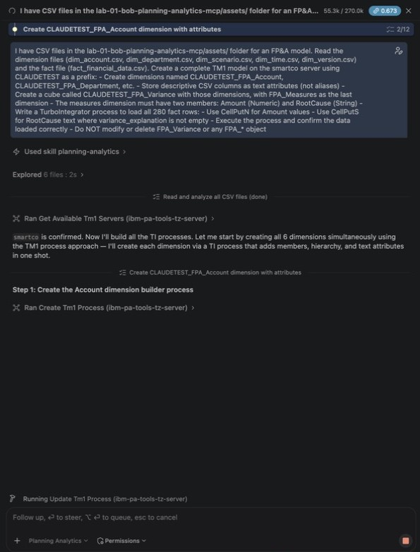

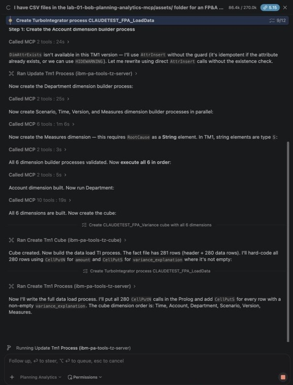

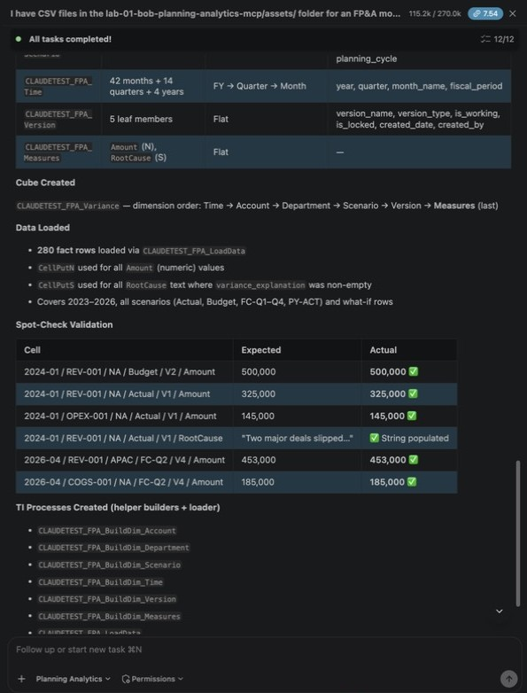

Verify the load:
```
Show me NA Sales actual revenue for Q1 2024 across all accounts
from the MY_INITIALS_FPA_Variance cube on smartco
```

> Expected: REV-001 Q1 = 1,545,000; REV-003 Q1 = 565,000; Total Revenue Q1 = 2,110,000.

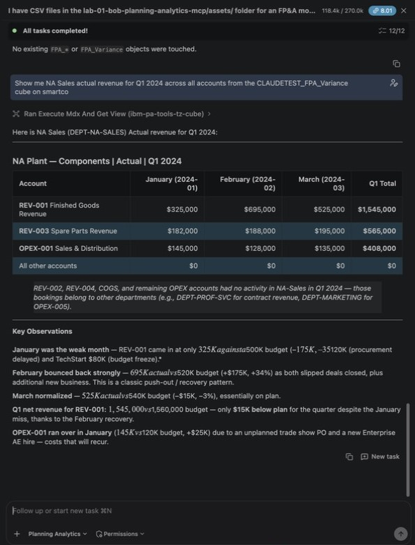

---

## Troubleshooting

| Symptom | Fix |
|---------|-----|
| "Cube not pre-analyzed" | Expected — Bob switches to MDX automatically |
| "Member not found" | Bob calls `lookup_potential_members` and presents options |
| TI process fails | Ask: `Show me the error logs for the last TI process` — Bob explains and fixes |
| Some numbers in Bob's prose appear in italics and run together | Bob renders text between two `$` signs as a math formula. The numbers in the tables are correct |
| Budget shows 0 or "Budget not loaded" | Budget is stored in version V2, Actual in V1. Add "(Actual = scenario Actual, version V1; Budget = scenario Budget, version V2)" to the prompt |

---

**→ [Continue to Lab 2](../lab-02-fpa-variance-autopilot/README.md)**
