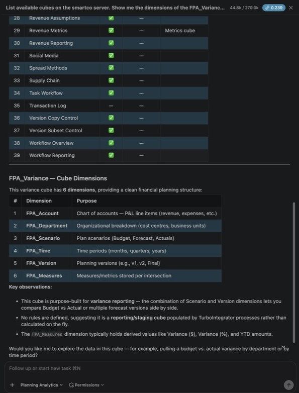
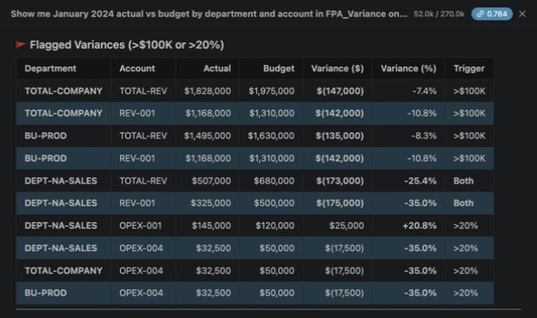

# Lab 2.0 — Confirm the FP&A Dataset

**Duration:** ~5 minutes  
**Prerequisite:** [Lab 1](../../lab-01-bob-planning-analytics-mcp/README.md) ✅

---

## Goal

Confirm `FPA_Variance` cube is loaded and spot-check the key variances the autopilot will investigate.

> **If you completed Lab 1 Exercise 5**, the cube is already loaded — run the check below and move on (~2 min).

---

## Check in Bob (📊 Planning Analytics mode)

```
List available cubes on the smartco server.
Show me the dimensions of the FPA_Variance cube.
```

Expected: `FPA_Account · FPA_Department · FPA_Scenario · FPA_Time · FPA_Version · FPA_Measures`



```
Show me January 2024 actual vs budget by department and account in FPA_Variance on smartco
(Actual = scenario Actual, version V1; Budget = scenario Budget, version V2).
Flag any variance greater than $100,000 or 20%.
```

> Keep the version hint in the prompt. Without it, Bob read Budget from version V1 in testing, got zeros, and reported actual amounts as variances.

Expected variances:

| Department | Account | Variance | Flag |
|-----------|---------|----------|------|
| DEPT-NA-SALES | REV-001 | -$175K (-35.0%) | 🔴 unfavorable |
| DEPT-NA-SALES | OPEX-001 | +$25K (+20.8%) | 🔴 unfavorable (expense over budget) |
| DEPT-NA-SALES | OPEX-004 | -$17.5K (-35.0%) | ✅ favorable (expense under budget) |

Bob also lists roll-up rows that cross the threshold (TOTAL-COMPANY, BU-PROD and NA's TOTAL-REV). At leaf level, nothing else crosses the threshold in January 2024 — for example EMEA REV-001 is +$40K (+10.5%) and should **not** be flagged. (Lab 2.2 uses separate revenue/expense thresholds, so it also reports IT OPEX-007 +18.7%.)



> If the cube is missing, ask your facilitator or re-run Lab 1 Exercise 5 (~8 min).

---

**Next, pick your path ([which one?](../README.md#choose-your-path)):**

- ⚡ **[Lab 2 Fast Path — Let Bob Build the Agents](../lab-02-fast-path-build-with-bob/README.md)**
- 🧭 **[Lab 2.1 — Configure the PA MCP Connection](../lab-02-1-pa-mcp-connection/README.md)** (step by step)
