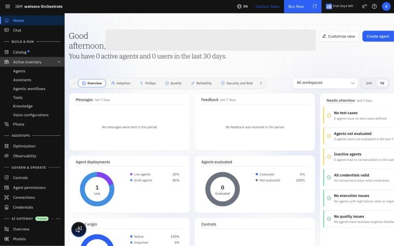

# Lab 2.1 — Configure the PA MCP Connection

**Duration:** ~10 minutes  
**Prerequisite:** [Lab 2.0](../lab-02-0-fpa-dataset-catchup/README.md) ✅

---

## Goal

Create the `planning-analytics-basic` connection and store team credentials in watsonx Orchestrate so agents can authenticate with the PA MCP server.

---

## Step 1 — Create the Connection

1. ☰ → **GOVERN & OPERATE** → **Connections** → **Add connection**
   (opens the *Security control center*, Connections tab — the old **Manage → Security** menu no longer exists)

   

2. **Define connection details** — fill in:

| Field | Value |
|-------|-------|
| **Connection ID** | `planning-analytics-basic` |
| **Display name** | `Planning Analytics (Basic Auth)` |

3. **Save and continue**

   > ⚠️ After this click the connection **cannot be renamed or deleted**. Double-check the Connection ID first.

4. **Configure draft environment** — Authentication type: **Basic Auth** · Credential type: **Team credentials**. The Username / Password fields appear right here:
   - **Username:** `pm`
   - **Password:** provided on the session credential sheet
   - **Server URL** (if the form asks for one): `http://<TECHZONE_HOST>:<PORT>/api/<TENANT_ID>/v0/agentic-ai/cube/mcp`
5. **Configure live environment** → **Paste draft configuration** (copies the settings *and* the password to Live) → **Add connection**

> ADK: `orchestrate connections create --name planning-analytics-basic --auth-type basic --credential-type team`

---

## Step 2 — Verify the Team Credentials

Team credentials are entered inside the connection wizard (Step 1), so there is nothing new to add. To verify:

1. ☰ → **Credentials** (Security control center → **Team credentials** tab)
2. `planning-analytics-basic` should show **Draft (1)** and **Live (1)**

> One connection serves both PA MCP endpoints — `/agentic-ai/cube/mcp` (Lab 2.2) and `/agentic-ai/analysis/mcp` (Lab 3).

> If the connection already exists, skip to Step 2 and verify credentials are set.

---

## ✅ Done when

`planning-analytics-basic` shows Draft (1) / Live (1) under **Credentials → Team credentials**.

---

**→ [Lab 2.2 — Create the PA Data Agent](../lab-02-2-pa-agent/README.md)**
