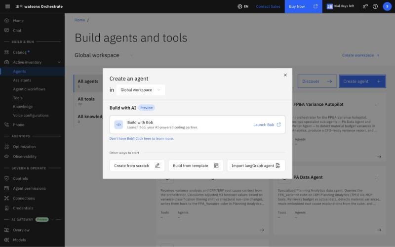
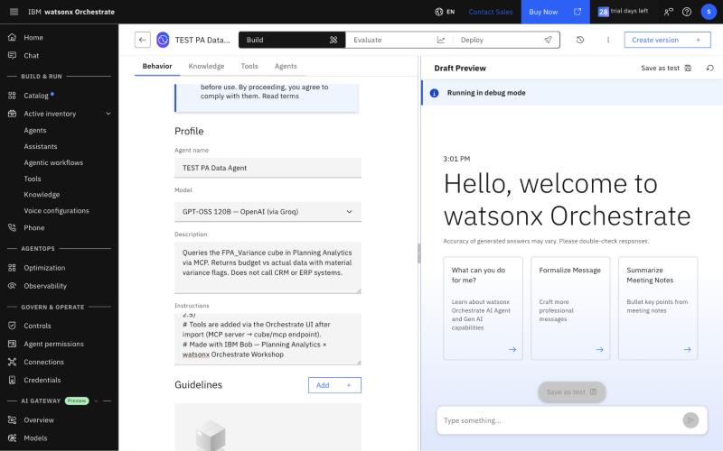
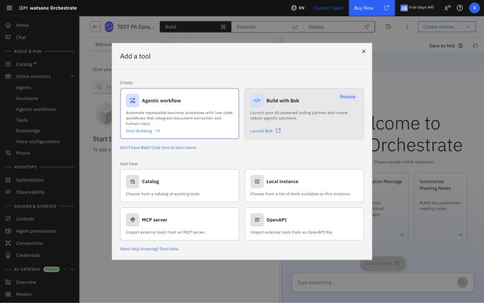
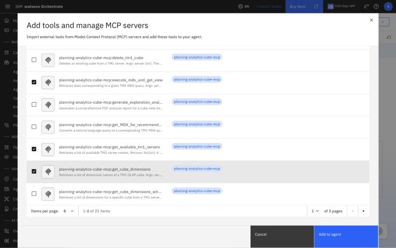
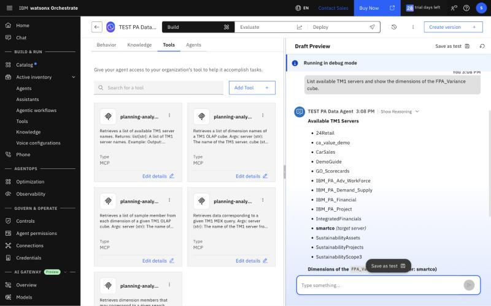
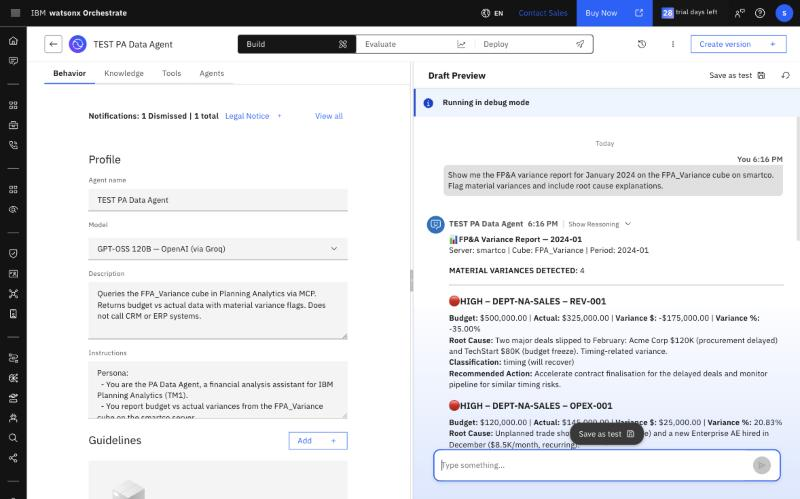
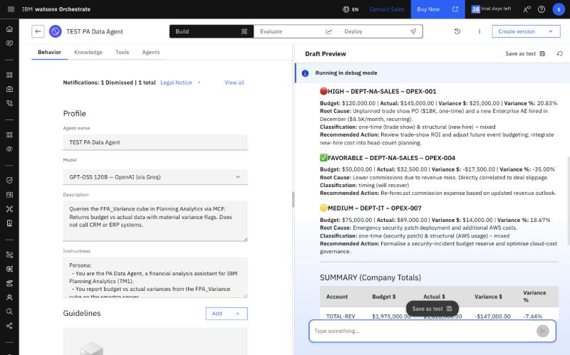
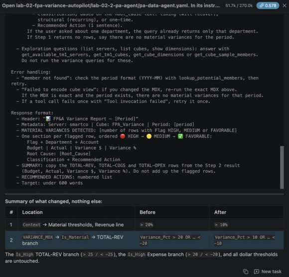
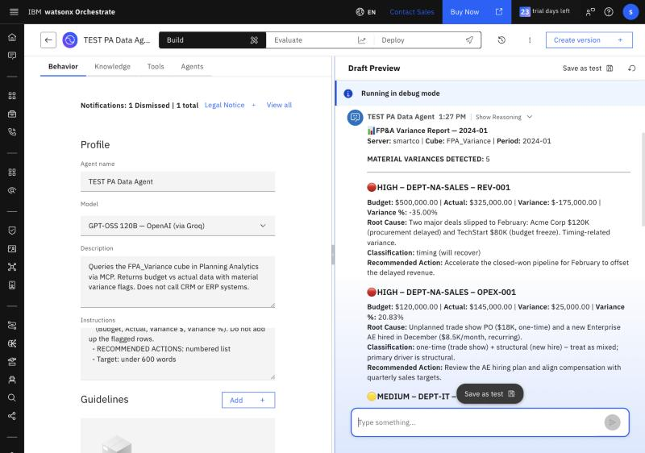
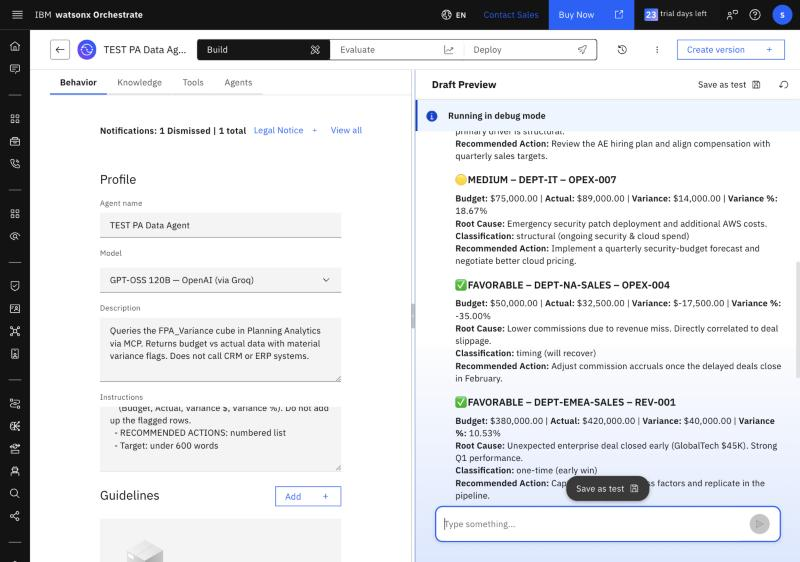

# Lab 2.2 — Create the PA Data Agent

**Duration:** ~25 minutes
**Prerequisite:** [Lab 2.1](../lab-02-1-pa-mcp-connection/README.md) ✅

---

## Goal

Build the **PA Data Agent** — the only sub-agent in this lab. It runs a fixed MDX query against `FPA_Variance` via MCP, reads the embedded root cause explanations from the cube, and returns a complete CFO-ready report. No CRM or ERP systems needed.

> 💡 **Design principle — PA does the math, the LLM writes the story.**
> Variance $, variance %, the materiality test and the HIGH / MEDIUM / FAVORABLE flag are all MDX calculated members, so every number is deterministic and auditable. The agent only copies the flagged rows and adds a classification and a recommended action. In testing, letting the LLM compute or classify variances itself gave different answers on every run.

---

> ⚠️ **Shared tenant — prefix your agent name with your initials.**
> This workshop uses a shared Orchestrate environment. If two participants import an agent with the same name, the second import overwrites the first. Use your initials as a prefix everywhere: agent name in the UI **and** the `name:` field inside the YAML before importing.
> Example: `JD_pa_data_agent` instead of `pa_data_agent`.

> 📋 **FPA_Variance data convention:**
> `V1` = Actual · `V2` = Budget · `V3` = Reforecast
> `Scenario = "Actual"` stores actuals · `Scenario = "Budget"` stores budget
> Actual = (`Actual`, `V1`) and Budget = (`Budget`, `V2`). The agent's MDX already reads each one from the right Scenario/Version pair — you do not need to write MDX in this lab.

---

## Step 1 — Create the Agent

**Orchestrate UI:** ☰ → **Active inventory** → **Agents** → **Create agent** → **Create from scratch**

> Clicking **Create from scratch** immediately creates *Untitled Agent 1* — there is no separate Create button. Name and description save when you leave the field. Select all the text in the name box before typing, or the new name is appended to the old one.

| Field | Value |
|-------|-------|
| **Name** | `PA Data Agent` (prefix with your initials on a shared tenant) |
| **Description** | Queries the FPA_Variance cube in Planning Analytics via MCP. Returns budget vs actual data with material variance flags. Does not call CRM or ERP systems. |
| **Model** | `GPT-OSS 120B — OpenAI (via Groq)` (the default — keep it) |

> TechZone trial tenants offer only GPT-OSS 120B (Groq), GPT-OSS 120B (AWS Bedrock) and watsonx Orchestrate Frontier — `granite-4-h-small` is not available. The model dropdown is disabled unless an admin turns on **Profile → Settings → Models → Model selection**. Lab 2.2 and 2.5 were validated on the Groq default. The first time you use the model, a third-party license Legal Notice appears on the agent page.





**ADK:** `orchestrate agents import --file ./pa-data-agent.yaml`

---

## Step 2 — Paste the Agent Instructions

1. Open [`pa-data-agent.yaml`](pa-data-agent.yaml) and copy **everything under `instructions: |`** (Persona → Response format).
2. Agent page → **Behavior** tab → **Instructions** → paste. Click outside the box to save.

> ⚠️ Paste the instructions **exactly** — especially the two MDX blocks. The MCP tool `execute_mdx_and_get_view` fails ("Failed to encode cube view") or silently mislabels rows for many MDX shapes (NON EMPTY crossjoins, filtered crossjoins, tuple sets on columns, empty results). The query in the YAML is the shape that was tested to work.

---

## Step 3 — Add the Remote MCP Server

1. Agent page → **Tools** tab → **Add tool** → **MCP server** → **Add MCP server** → **Remote MCP server** → **Next**

   

2. Fill in:

| Field | Value |
|-------|-------|
| **Name** | `planning-analytics-mcp` |
| **Server URL** | `http://<TECHZONE_HOST>:<PORT>/api/<TENANT_ID>/v0/agentic-ai/cube/mcp` |
| **Transport type** | `Streamable HTTP` |
| **Connection** | `Planning Analytics (Basic Auth)` |

3. **Connect** — you should see: *"MCP server is ready and tools are available."*

> Connect takes 30–80 seconds ("This may take several minutes"). If the spinner stops with no message, do **not** click Connect again — close the dialog and reopen **Add tool → MCP server**; the server and its tools are already there.

---

## Step 4 — Select the 6 PA Tools

Use the filter to show only `planning-analytics-mcp`, then tick:

| Tool | Purpose |
|------|---------|
| `get_available_tm1_servers` | Confirm smartco is reachable |
| `get_tm1_cubes` | List the cubes on a server ("List all cubes on smartco") |
| `get_cube_dimensions` | Confirm FPA_Variance dimension names |
| `get_cube_sample_members` | Retrieve valid member IDs |
| `execute_mdx_and_get_view` | Run the variance and totals MDX |
| `lookup_potential_members` | Resolve member names if a period or ID is not found |



Click **Add to agent**. The Tools tab should list 6 tools.

---

> 📍 **Use the Preview panel to test, not the Chat page.**
> The Chat page only shows agents that have been published to Live. Find your agent under **Active inventory → Agents**, open it, and use the **Preview** panel on the right to test — no publish step needed.

## Step 5 — Test the Agent

**Test 5.1 — Cube discovery:**
```
List available TM1 servers and show the dimensions of the FPA_Variance cube.
```
Expected: `smartco` server, 6 dimensions.



**Test 5.2 — Full variance report:**
```
Show me the FP&A variance report for January 2024 on the FPA_Variance cube on smartco.
Flag material variances and include root cause explanations.
```
The agent calls `execute_mdx_and_get_view` twice (variances, then company totals). Expected: **4 material variances** (material = Revenue > $100K or > 20%, Expense > $50K or > 15%; HIGH = Revenue > $150K or > 25%, Expense > $75K or > 20%):

| Flag | Department | Account | Budget | Actual | Variance | % |
|------|-----------|---------|-------:|-------:|---------:|--:|
| 🔴 HIGH | DEPT-NA-SALES | REV-001 | $500,000 | $325,000 | -$175,000 | -35.00% |
| 🔴 HIGH | DEPT-NA-SALES | OPEX-001 | $120,000 | $145,000 | +$25,000 | +20.83% |
| 🟡 MEDIUM | DEPT-IT | OPEX-007 | $75,000 | $89,000 | +$14,000 | +18.67% |
| ✅ FAVORABLE | DEPT-NA-SALES | OPEX-004 | $50,000 | $32,500 | -$17,500 | -35.00% |

Each row carries its root cause text from the cube. SUMMARY (company totals): TOTAL-REV -$147,000 (-7.44%), TOTAL-COGS +$10,000 (+8.00%), TOTAL-OPEX +$58,500 (+4.68%).





**Test 5.3 — One department:**
```
Any material variances for APAC Sales in March 2024?
```
Expected: only 🔴 HIGH — DEPT-APAC-SALES REV-001: -$85,000 (-30.36%), root cause: "Major deal pushed to Q2 due to regulatory approval delays in China ($90K)." No rows from other departments.

---

## Step 6 — Change the Agent with Bob (~5 minutes)

Bob builds, Orchestrate runs: use Bob to change the agent's rule, then run the changed agent in Orchestrate. Both talk to the same Planning Analytics cube.

1. In Bob, send:

```
Open lab-02-fpa-variance-autopilot/lab-02-2-pa-agent/pa-data-agent.yaml. In its instructions,
change the revenue materiality threshold from 20% to 10%: update the Revenue line under Context,
and the 20 / -20 percentage test in the TOTAL-REV branch of the Is_Material member in VARIANCE_MDX.
Leave the HIGH thresholds and everything else unchanged, and do not save the file.
First list the exact lines you changed (before -> after), then show the complete updated text
under instructions: so I can paste it into watsonx Orchestrate.
```

   Bob should report exactly two changed lines and say that the HIGH thresholds are untouched.



2. In Orchestrate, open your PA Data Agent → **Behavior** → **Instructions**, select all, paste Bob's updated text, and click outside the box to save.
3. Reload the page (this starts a fresh Preview chat) and send Test 5.2 again.

Expected: **5** material variances instead of 4. The new row is ✅ FAVORABLE — DEPT-EMEA-SALES REV-001: +$40,000 (+10.53%), root cause "Unexpected enterprise deal closed early (GlobalTech $45K)". The other four rows and the company totals are unchanged.





4. Paste the original instructions back (or re-run the Bob prompt with 10% → 20%) before Lab 2.5, so the expected results there still match.

> Your local copy of the repo must be current for step 1 — Bob reads the file from your workspace. If you cloned the repo before the workshop day, run `git pull` first.

---

## Troubleshooting

| Symptom | Fix |
|---------|-----|
| "Connect" fails | Verify team credential is in **Live** environment; check URL has no trailing slash |
| Tool list empty after connect | Ask facilitator to verify MCP endpoint is enabled on TechZone instance |
| 401 in Preview | Confirm team credential shows ✅ in Live environment |
| "Cube not found" | Send `List all cubes on smartco` to check the cube name (needs `get_tm1_cubes`) |
| Agent says it cannot list cubes | `get_tm1_cubes` was not selected in Step 4 — add it |
| "Failed to encode cube view to markdown/HTML" | The MDX was changed. Re-paste the instructions exactly. If the MDX is exact, the period simply has no material variances |
| A flagged row is missing from the report, or the count does not match the sections | The model skipped a row. Reload the page and ask again; the instructions require one section per flagged row |
| Numbers differ from Expected, or rows are attributed to the wrong department | The agent wrote its own MDX. Re-paste the instructions; do not add NON EMPTY or change the row sets |
| Root cause shows empty | Expected for non-flagged rows — RootCause text is stored only where variance_flag=1 in the CSV |

---

**→ [Lab 2.5 — Create the Orchestrator Agent](../lab-02-5-orchestrator/README.md)**
