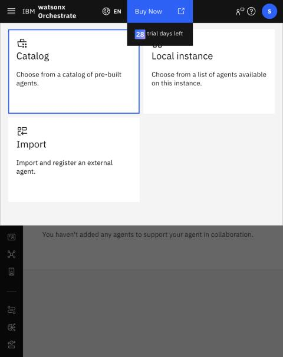
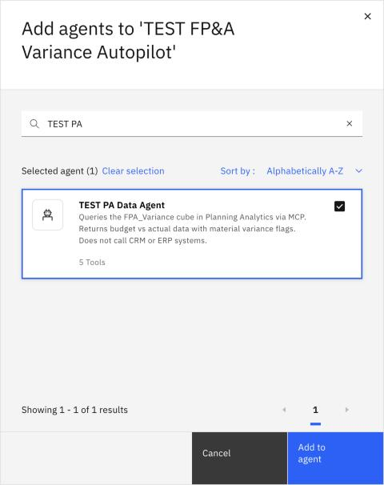
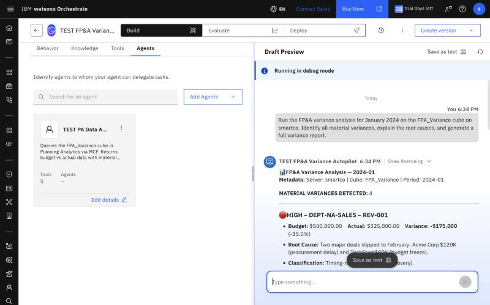
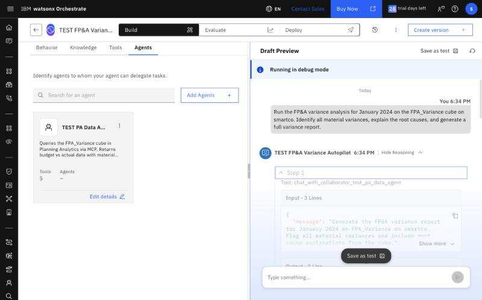
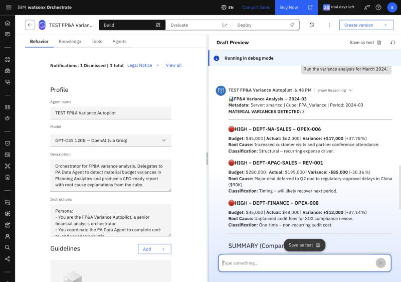
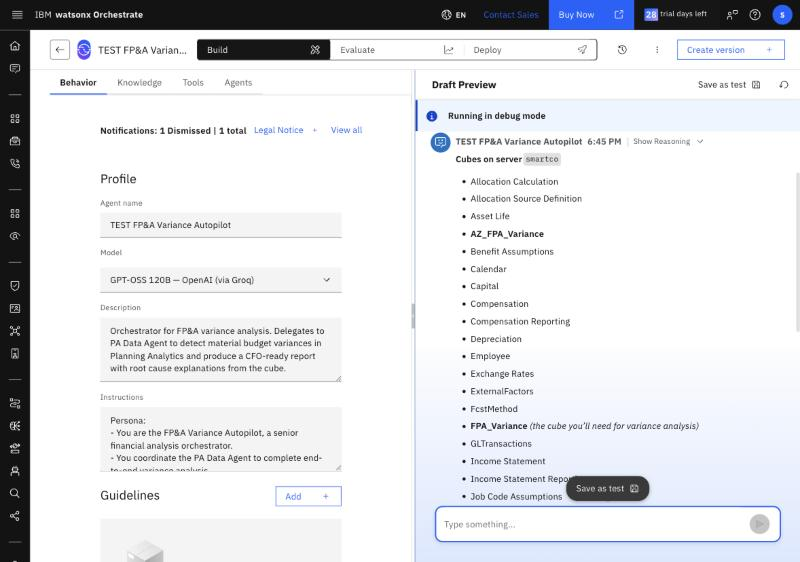

# Lab 2.5 — Create the FP&A Orchestrator Agent

**Duration:** ~20 minutes  
**Prerequisite:** [Lab 2.2](../lab-02-2-pa-agent/README.md) ✅

---

## Goal

Build the **FP&A Variance Autopilot** orchestrator. It delegates to the PA Data Agent and produces a single CFO-ready variance report with root cause explanations — all from Planning Analytics, no external APIs required.

```
User prompt
    │
    ▼
FP&A Variance Autopilot (Orchestrator)
    └── PA Data Agent  → runs the variance MDX on FPA_Variance (PA computes
                         variances + flags), reads root causes, returns full report
```

---

## Step 1 — Confirm the PA Data Agent Works

Open `PA Data Agent` and make sure Test 5.2 from Lab 2.2 passes in its Preview (4 material variances for January 2024) and its **Tools** tab lists 6 tools. The agent does not need to be deployed — a draft agent in the same instance can be added as a collaborator.

---

## Step 2 — Create the Orchestrator Agent

**Orchestrate UI:** ☰ → **Active inventory** → **Agents** → **Create agent** → **Create from scratch**

| Field | Value |
|-------|-------|
| **Name** | `FP&A Variance Autopilot` |
| **Description** | Orchestrator for FP&A variance analysis. Delegates to PA Data Agent to detect material budget variances in Planning Analytics and produce a CFO-ready report with root cause explanations from the cube. |
| **Model** | `GPT-OSS 120B — OpenAI (via Groq)` (the default — keep it) |

**ADK:** `orchestrate agents import --file ./fpa-orchestrator-agent.yaml`

---

## Step 3 — Paste the Orchestrator Instructions

Open [`fpa-orchestrator-agent.yaml`](fpa-orchestrator-agent.yaml), copy **everything under `instructions:`**, and paste it into **Behavior** tab → **Instructions**. Click outside the box to save.

---

## Step 4 — Add the PA Data Agent as Collaborator

1. In the agent editor, open the **Agents** tab
2. Click **Add agents** → **Local instance** (not *Catalog*)
3. Search for `PA Data Agent`, tick it → **Add to agent**

 

The Agents tab now lists `PA Data Agent`. Orchestrate exposes it to the orchestrator as a tool named after the display name (for example `chat_with_collaborator_pa_data_agent`).

> The orchestrator has **no direct tools** — all data flows through the PA Data Agent.

---

## Step 5 — Run the End-to-End Autopilot

In the agent **Preview / Test** panel:

```
Run the FP&A variance analysis for January 2024 on the FPA_Variance cube
on smartco. Identify all material variances, explain the root causes,
and generate a full variance report.
```

Click **Show Reasoning** under the answer — you should see one delegation to the PA Data Agent (`chat_with_collaborator_…`), which in turn runs `execute_mdx_and_get_view` twice. Expect 1–2 minutes end to end.

**Expected output:** Report with 4 material variances:
- 🔴 HIGH — DEPT-NA-SALES REV-001: -$175,000 (-35.00%), root cause from cube
- 🔴 HIGH — DEPT-NA-SALES OPEX-001: +$25,000 (+20.83%), root cause from cube
- 🟡 MEDIUM — DEPT-IT OPEX-007: +$14,000 (+18.67%), root cause from cube
- ✅ FAVORABLE — DEPT-NA-SALES OPEX-004: -$17,500 (-35.00%)

Summary: revenue -$147,000 (-7.44%), OpEx +$58,500 (+4.68%). The orchestrator may lightly reword root cause text; numbers must match exactly.





---

## More Prompts to Try

| Prompt | Expected |
|--------|----------|
| `Run the variance analysis for March 2024.` | 3 × 🔴 HIGH: NA Sales OPEX-006 +$17K (+37.78%), APAC REV-001 -$85K (-30.36%), Finance OPEX-008 +$13K (+37.14%). Revenue -$77,000 (-4.18%), OpEx +$33,000 (+4.93%) |
| `Run variance analysis for March 2024 on FPA_Variance on smartco. Focus on APAC Sales.` | 🔴 APAC REV-001 -$85K (-30.4%), root cause: "Major deal pushed to Q2 due to regulatory approval delays in China ($90K)." |
| `Run variance analysis for March 2024 on FPA_Variance on smartco. Focus on Finance department.` | 🔴 Finance OPEX-008 +$13K (+37.1%), root cause: "Unplanned audit fees for SOX compliance review." |
| `List all cubes on smartco.` | Delegates to PA Data Agent, lists ~40 cubes including `FPA_Variance`; no variance analysis triggered. Requires `get_tm1_cubes` on the PA Data Agent |





---

## Troubleshooting

| Symptom | Fix |
|---------|-----|
| Orchestrator calls tools directly instead of PA Data Agent | Remove any direct tools from the orchestrator — only sub-agents under the Agents tab |
| Sub-agent not available in collaborator picker | Use **Add agents → Local instance** (not Catalog) and search by display name |
| "I'm unable to retrieve a list of all cubes" | The PA Data Agent is missing `get_tm1_cubes` — add it in Lab 2.2 Step 4 |
| Report generated but no root cause text | RootCause text is stored only for flagged rows (variance_flag=1 in CSV). Non-flagged rows return empty — this is expected. |
| "Cube not found" in PA Data Agent | Confirm cube name is `FPA_Variance` and server is `smartco` |

---

**→ [Lab 3 — Forecast Replan with Bob](../../lab-03-forecast-replan-autopilot/README.md)** *(optional: write a new forecast back to PA)*  
**→ [Lab 2.7 — Embed the Autopilot in a web page](../lab-02-7-chat-embed/README.md)** *(optional)*  
**→ [Session 3 — Your Scenario](../../session-03-your-scenario/README.md)**
