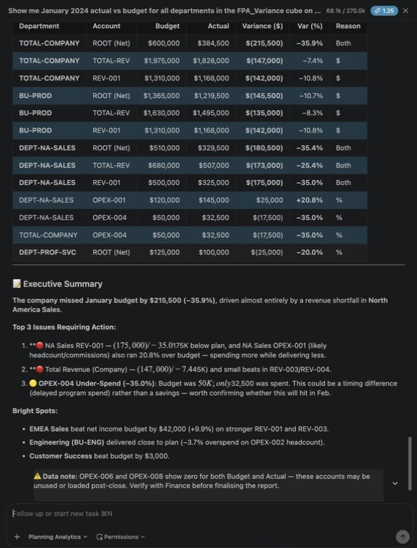
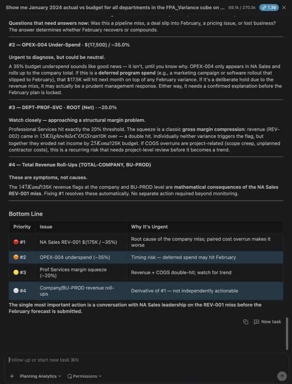
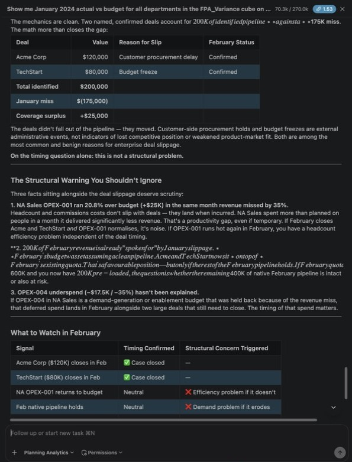
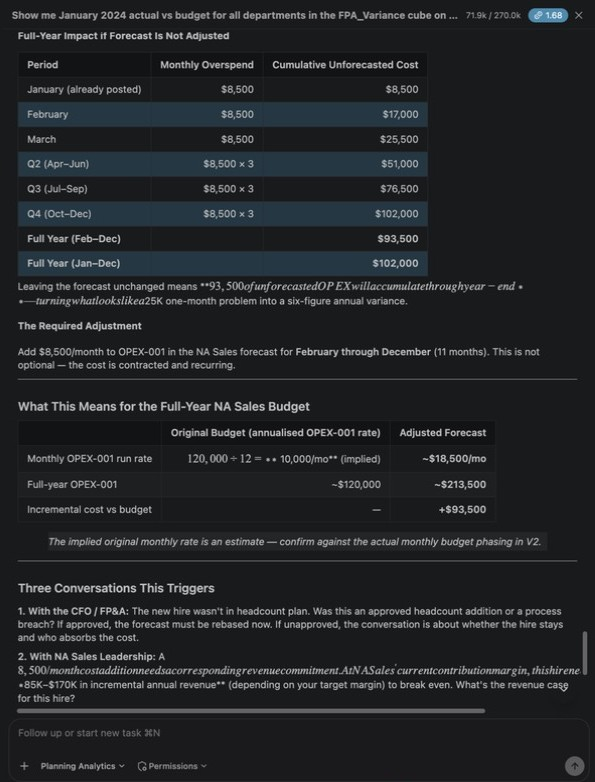
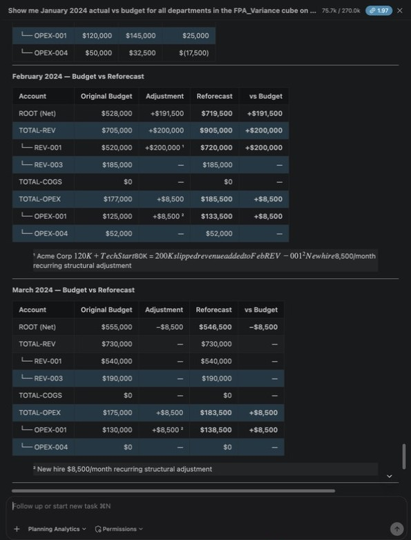
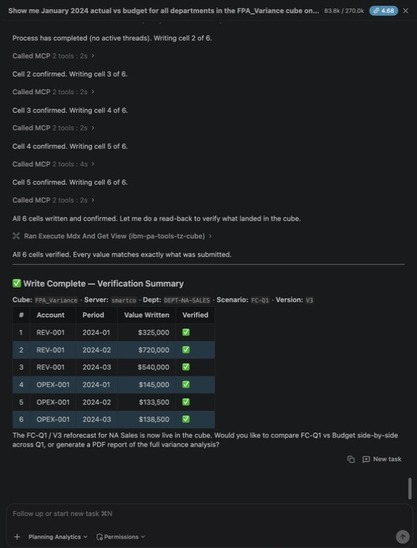
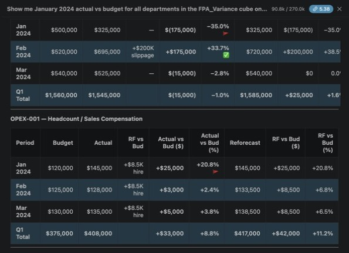
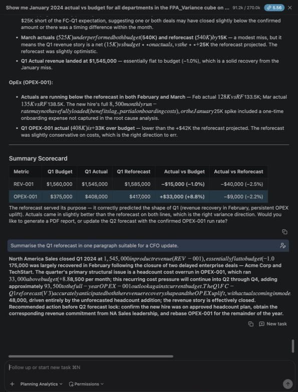
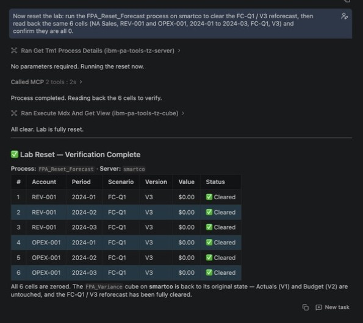

# Lab 3 — Forecast Replan with Bob

**Duration:** 30 minutes  
**Mode:** 📊 Planning Analytics  
**Prerequisite:** [Lab 1 Exercise 5](../lab-01-bob-planning-analytics-mcp/README.md) ✅ (`FPA_Variance` cube built)

---

## What You Will Do

Lab 1 taught you how to **read** data from Planning Analytics. This lab teaches you how to **change** it.

You will use Bob to:
1. Find material budget variances in `FPA_Variance`
2. Understand the root cause of each variance
3. Calculate adjusted forecast values
4. Write the new forecast back into Planning Analytics
5. Verify the update

One conversation. No external tools. No code.

| Exercise | Task | Time |
|----------|------|------|
| [1](#exercise-1--find-the-variances) | Find material variances | 5 min |
| [2](#exercise-2--understand-the-root-cause) | Understand what caused them | 5 min |
| [3](#exercise-3--calculate-the-reforecast) | Calculate adjusted forecast values | 8 min |
| [4](#exercise-4--write-back-to-pa) | Write the new forecast into PA | 7 min |
| [5](#exercise-5--verify) | Verify and compare versions | 5 min |

Switch to **📊 Planning Analytics** mode before starting.

---

## Exercise 1 — Find the Variances

```
Show me January 2024 actual vs budget by department and account in FPA_Variance on smartco
(Actual = scenario Actual, version V1; Budget = scenario Budget, version V2).
Flag any variance greater than $100,000 or 20%.
```

> Keep "by department and account" and the version hint. Without them, Bob reported department totals (revenue minus costs) instead of the account-level variances below.

You should see three flagged variances at account level (threshold: >$100K or >20%). Bob also lists roll-up rows such as TOTAL-COMPANY and BU-PROD:
- 🔴 NA Sales / Finished Goods Revenue (REV-001): -$175K (-35%)
- 🔴 NA Sales / Sales & Distribution OPEX (OPEX-001): +$25K (+20.8%)
- ✅ NA Sales / Sales Commissions (OPEX-004): -$17.5K (-35%) — Favorable



```
Which of these variances is more urgent and why?
```

Expected: NA Sales REV-001 ranked first.



---

## Exercise 2 — Understand the Root Cause

```
For the NA Sales revenue miss of -$175K in January 2024:
The root cause is deal slippage — two enterprise deals moved to February.
Acme Corp ($120K) delayed by customer procurement, TechStart ($80K) by a budget freeze.
Both deals are confirmed for February. Is this a timing issue or a structural problem?
```

```
For the NA Sales OpEx overspend of +$25K in January 2024:
The root cause is an unbudgeted trade show PO ($18K) plus a new hire 
that started in December ($8,500/month recurring). 
What kind of forecast adjustment does this require?
```

> Bob will classify each variance as **timing** (recovers next month) or **structural** (recurring run-rate change). This classification drives the reforecast calculation in Exercise 3.

Expected: the revenue miss is **timing** ($200K of confirmed deals covers the $175K miss). The OpEx overspend needs a **structural** +$8,500/month from February, and the $18K trade show is one-time.





---

## Exercise 3 — Calculate the Reforecast

```
Based on the root causes above, calculate the Q1 2024 reforecast for NA Sales.
Apply these rules:
- Revenue slippage (timing): move the slipped amount to the recovery month
- Recurring cost increase (structural): apply the new run-rate to remaining months
- One-time cost (non-recurring): no adjustment to future months
Show me the full reforecast table before writing anything.
```

Expected calculation (budgets come from the CSV — Feb/Mar are not flat $500K/$120K):

| Period | Account | Budget (V2) | Reforecast (FC-Q1 / V3) | Change | Reason |
|--------|---------|-------------|------------------------|--------|--------|
| Jan 2024 | REV-001 | $500,000 | $325,000 | -$175K | Matches actual — deals moved out |
| Feb 2024 | REV-001 | $520,000 | $720,000 | +$200K | Recovery: Acme $120K + TechStart $80K |
| Mar 2024 | REV-001 | $540,000 | $540,000 | — | Unchanged |
| Jan 2024 | OPEX-001 | $120,000 | $145,000 | +$25K | Matches actual |
| Feb 2024 | OPEX-001 | $125,000 | $133,500 | +$8.5K | New hire run-rate, no repeat PO |
| Mar 2024 | OPEX-001 | $130,000 | $138,500 | +$8.5K | New hire run-rate continues |



```
What is the net Q1 impact on revenue and OpEx from these adjustments?
```

Expected, for the two accounts being reforecast: REV-001 Q1 reforecast $1,585,000 vs budget $1,560,000 (**+$25K**), and OPEX-001 Q1 reforecast $417,000 vs budget $375,000 (**+$42K**).

> Check Bob's answer against its own reforecast table. In testing Bob called the deal slips a "wash" and reported revenue as +$2K. That ignores that the $200K recovery is larger than the $175K January miss.
---

## Exercise 4 — Write Back to PA

Once you're happy with the numbers:

```
Stay in Planning Analytics mode: the PA MCP tools in this workspace can run TI processes.
Write exactly these 6 cells to FPA_Variance on smartco with the FPA_Write_Forecast process
(department DEPT-NA-SALES, scenario FC-Q1, version V3):
REV-001 2024-01 = 325000, REV-001 2024-02 = 720000, REV-001 2024-03 = 540000,
OPEX-001 2024-01 = 145000, OPEX-001 2024-02 = 133500, OPEX-001 2024-03 = 138500.
Write one cell at a time and confirm each write.
```

> Two things went wrong with a vaguer prompt in testing. Bob refused because the planning-analytics skill says TI work belongs in "Advanced mode", and it planned 8 different cells (February and March only, plus REV-003 and OPEX-004). If Bob still asks you to switch modes, reply `Go ahead in this mode`.

> Bob will call `execute_tm1_processes_asynchronously` with the `FPA_Write_Forecast` TI process for each cell. You will see it confirm each write before moving to the next.

Watch for the confirmation after each cell. Bob first reads the process parameters (`pTime`, `pAccount`, `pDept`, `pScenario`, `pVersion`, `pAmount`), then writes each cell and reads all six back:



---

## Exercise 5 — Verify

```
For NA Sales REV-001 and OPEX-001, January through March 2024, show:
- Actual (scenario Actual, version V1)
- Budget (scenario Budget, version V2)
- Reforecast (scenario FC-Q1, version V3)
side by side in FPA_Variance on smartco.
```

Expected: V3 values match exactly what was calculated in Exercise 3.



```
Summarise the Q1 reforecast in one paragraph suitable for a CFO update.
```



---

## Reset (facilitator, after the session)

```
Run the FPA_Reset_Forecast process on smartco to clear the FC-Q1 / V3 reforecast,
then read back the 6 cells (NA Sales, REV-001 and OPEX-001, 2024-01 to 2024-03, FC-Q1, V3)
and confirm they are all 0.
```



---

## Troubleshooting

| Symptom | Fix |
|---------|-----|
| "Process FPA_Write_Forecast not found" | Ask your facilitator to run the Lab 3 setup (takes 2 min) |
| V3 shows 0 after write | Ask Bob: `Read back V3 for REV-001 / DEPT-NA-SALES / FC-Q1 / 2024-01 in FPA_Variance` to confirm |
| Bob calculates wrong recovery amount | Re-read Exercise 3 — confirm the total slipped value is $200K ($120K + $80K) |
| Bob says writing needs "Advanced mode" | Reply `Go ahead in this mode` — Planning Analytics mode can run the TI process |
| Text in Bob's answer turns into italics and runs together | Bob renders text between two `$` signs as a formula. The numbers in the tables are correct |

---

**→ [Session 3 — Your Scenario](../session-03-your-scenario/README.md)**
